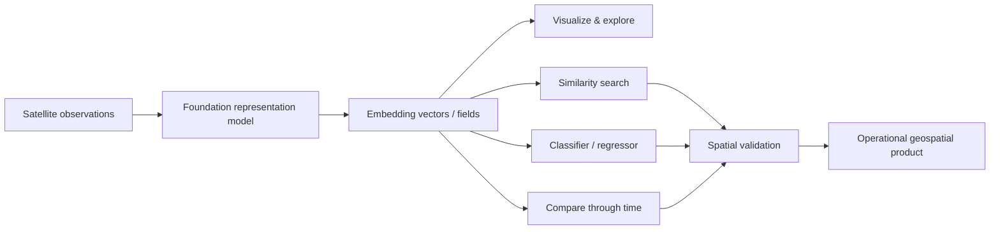
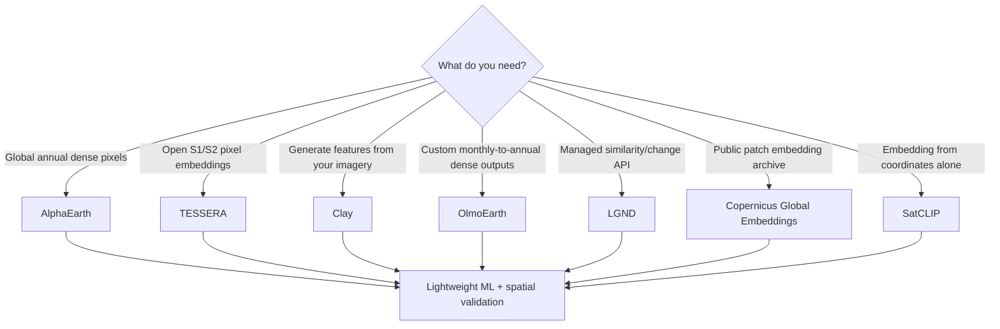
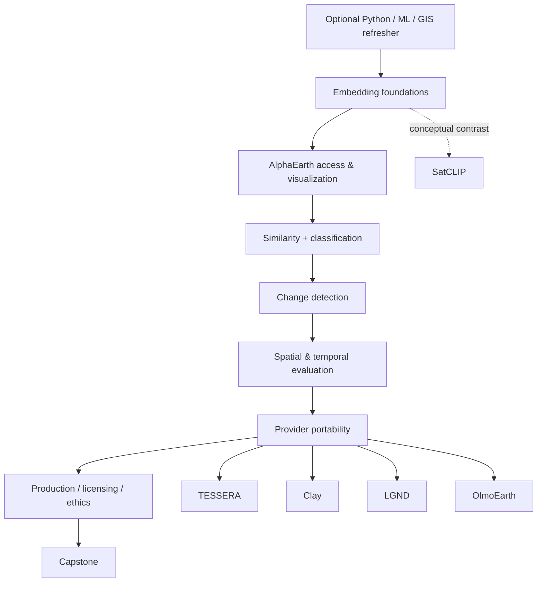
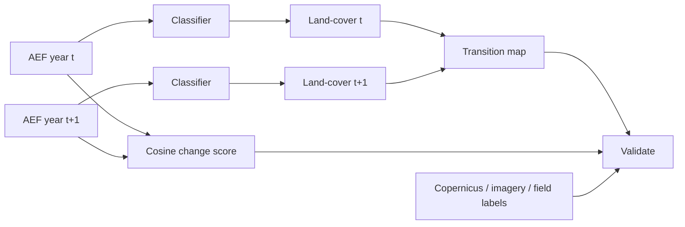

# Introduction to Geospatial Embeddings — Research and Course Design Report

## Executive summary

I understand the goal as designing a roughly six-hour, developer-oriented Udemy course that teaches **how to use geospatial embeddings as practical data products**, rather than how to train large Earth-observation foundation models from scratch. That distinction should drive the entire curriculum.

The field has matured unusually quickly. A useful 2026 taxonomy separates Earth embeddings into **implicit location embeddings** such as SatCLIP, **explicit patch embeddings** that summarize image chips, and **explicit pixel embeddings** such as AlphaEarth and TESSERA that provide a vector at every mapped pixel. The August 2026 *Earth Embeddings* survey argues that EO is moving from “download imagery → run foundation model → extract features” toward **embeddings-as-data**, where pretrained representations themselves become reusable geospatial datasets. This is exactly the right conceptual frame for an introductory developer course. citeturn18search0turn18search4

My strongest recommendation is:

> **Build the course around AlphaEarth Foundations / Google Satellite Embedding, then deliberately teach portability to TESSERA, Clay, LGND, OlmoEarth and Copernicus embeddings.**

AlphaEarth is presently the best teaching backbone because students can work with global, analysis-ready, annual, **10 m / 64-dimensional pixel embeddings** without installing or running the foundation model. Google now publishes 2017–2025 embeddings as Cloud-Optimized GeoTIFFs and also serves the dataset through Earth Engine; the dataset is CC BY 4.0. citeturn15search0turn15search2 TESSERA is the best complementary open pixel-embedding system because its model, data tooling and precomputed embeddings are openly accessible and it is backed by a CVPR 2026 paper. citeturn18search3turn14search7 Clay is the best example of **generating embeddings from imagery yourself** using an open foundation model. citeturn14search2turn14search8 LGND is useful for teaching a **managed embeddings/search API** and now additionally provides 15.2 billion precomputed Clay embeddings openly. citeturn17search1turn15search1 OlmoEarth has become especially relevant in 2026 because it exposes configurable pixel embeddings from Sentinel-1/2 and also releases models for local execution. citeturn20search0turn20search3

The course should **not** spend substantial time on transformer architecture, MAE training, distributed pretraining or full fine-tuning. Six hours is insufficient, and those topics obscure the more important developer skills:

1. understanding what an embedding represents spatially and temporally;
2. accessing and manipulating embedding fields;
3. similarity search and unsupervised exploration;
4. lightweight classification/regression using embeddings as features;
5. temporal/change analysis;
6. rigorous **spatial and temporal validation**;
7. choosing between pixel, patch and location embeddings;
8. moving the same downstream problem between providers.

A particularly good running project would be **land artificialization and vegetation/grass-cover change**. AlphaEarth is suitable for semantic change and classification, Dynamic World can provide convenient exploratory labels, and Copernicus HRL Imperviousness can provide a much stronger European reference for artificial surfaces. However, Dynamic World itself is a model output rather than independent ground truth, so students should explicitly learn why validating one learned representation against another learned product is insufficient. Dynamic World supplies nine 10 m class probabilities from Sentinel-2 from 2015 onward; Copernicus imperviousness products directly target sealed/built surfaces. citeturn5search0turn5search6

### Recommended course positioning

I would title it **“Introduction to Geospatial Embeddings: Satellite AI with AlphaEarth, Clay, TESSERA and More”**. “Geospatial” without a hyphen is the dominant technical usage.

The pedagogical progression should be:



The critical teaching message is that **an embedding is neither a land-cover class nor a physical measurement**. It is a learned representation. An individual AlphaEarth dimension such as `A17` should therefore not be interpreted like “red reflectance,” “NDVI,” or “fraction grass.” Google explicitly distinguishes the embedding dimensions from conventional spectral bands and indices with physical meaning. citeturn15search2


## Provider landscape and prioritized getting-started resources

### Provider comparison

The providers are not directly interchangeable. AlphaEarth and TESSERA primarily offer dense embedding fields; Clay and Prithvi are principally models; LGND is an infrastructure/search layer; OlmoEarth combines a foundation model with a managed generation platform; SatCLIP maps coordinates rather than current satellite observations into embeddings. The distinction should be taught explicitly. citeturn18search0

| Provider / system | Embedding type | Resolution / dimensionality | Temporal behavior | Access | Cost as of Aug. 2026 | Licensing / openness | Best course role |
|---|---|---|---|---|---|---|---|
| **Google AlphaEarth Foundations / Satellite Embedding** | Dense explicit pixel embedding | **10 m, 64D**, unit-length vectors | Annual. Official GCS currently contains **2017–2025** | Earth Engine `GOOGLE/SATELLITE_EMBEDDING/V1/ANNUAL`; GCS COGs | Dataset itself is published openly; GCS README says bucket is “provider pays.” Earth Engine has separate usage/quota/pricing rules. | **CC BY 4.0**, specified Google/DeepMind attribution | **Primary teaching backbone**: visualization, similarity, classification, regression, change citeturn15search0turn15search2 |
| **TESSERA / GeoTessera** | Dense explicit pixel embedding from S1/S2 time series | Current GeoTessera documentation describes **10 m, 128-channel** representation maps | Annual; precomputed coverage depends on year/version/region, with missing-tile requests supported | `pip install geotessera`; cloud-hosted embeddings; open inference model | No per-query API price for the open workflow; local/cloud compute and transfer remain user costs | Current project states software MIT; embeddings/model assets are openly released, with project licensing documented in repo | **Best open alternative to AlphaEarth** and good lesson in provider independence citeturn18search3turn14search7 |
| **Clay v1.5** | Patch/image embedding generator / backbone | Quick start produces **1024D** embeddings; spatial scale depends on source imagery and chip | User chooses image/time input rather than consuming a fixed annual global field | PyTorch model from GitHub + weights from Hugging Face | Model free; user pays own compute/storage | Code and weights **Apache-2.0**; documentation CC BY; published training-data embeddings ODC-BY | Teach **where embeddings come from** and custom imagery workflows citeturn14search2turn14search8 |
| **LGND** | Managed chip embeddings, indexes, search/change API; hosts multiple models | Depends on imagery/model/chip configuration | Custom collection/time ranges; pre-generated collections also available | REST/OpenAPI; search by chip/location/text, changed-chip search; embedding export on subscribed tiers | Trial 1,000 credits; Developer **$20/mo / 5,000 credits**; Pro **$499/mo / 150,000 credits**; Enterprise custom | Licensing depends on source/model; its separate open Clay corpus is CC BY 4.0 | Teach **production API / vector-search abstraction** citeturn17search0turn17search5 |
| **LGND open Clay corpus** | Precomputed patch/chip embeddings | Clay v1.5: documented 1,280 m / 256D and 2,560 m / 1024D configurations | Monthly aggregation | Source Cooperative, GeoParquet | Free public dataset | **CC BY 4.0** | Excellent cloud-native GeoParquet lab without an API account citeturn15search1turn17search11 |
| **OlmoEarth** | Configurable dense pixel embeddings plus open foundation model | Studio supports **10/20/40/80 m** and Nano 128D, Tiny 192D, Small 384D, Base 768D | **1–12 months** of context, allowing seasonal/monthly or annual products | OlmoEarth Studio/API or publicly available model code | Public pricing for embedding generation was **not specified in the official resources reviewed**; platform access is account/request based | Models have an OlmoEarth Artifact License rather than a simple OSI software license; source/model resources are publicly downloadable | Important 2026 comparison: **custom temporal windows** vs AlphaEarth annual fields citeturn20search0turn20search2turn20search4 |
| **Copernicus Global Embeddings Dataset** | Explicit image-fragment / patch embeddings, multiple models | Source products include 10 m Sentinel-2 and Sentinel-1; embedding patch shape depends on model/tile preprocessing | Based on individual source observations rather than one universal annual embedding product | EODATA S3; **GeoParquet** | Public CDSE access; no separate per-embedding price found | Dataset page did not state a simple standalone embedding license in the material reviewed; verify current CDSE/source-model terms before redistribution | Excellent **European public-cloud/multi-model** example citeturn14search0turn14search3 |
| **Prithvi-EO-2.0** | EO foundation-model features/backbone | Pretrained from NASA HLS 30 m time series; several model sizes | Multitemporal input | Hugging Face, NASA/IBM code, TerraTorch | Open/local compute | Model and repository terms documented through Hugging Face/NASA; check selected checkpoint | Optional advanced lesson on model/backbone workflows rather than embeddings-as-data citeturn11search0turn11search1turn11search2 |
| **SatCLIP** | **Implicit location embedding** | 512D representation from longitude/latitude rather than current satellite pixels | No observation timestamp required at inference | Open model + notebooks | Free/local compute | MIT repository; individual supporting datasets may have additional restrictions | Ideal 10-minute contrast: “place embedding” versus “observed surface embedding” citeturn13search2turn13search5 |

There is one subtle AlphaEarth documentation issue worth teaching students to notice: Google’s newer GCS documentation explicitly lists **2017–2025**, while the Earth Engine catalog metadata still displays an availability end at January 1, 2025, i.e. through calendar year 2024. For a course, use 2023–2024 in Earth Engine exercises and describe 2025 as available through the current GCS distribution unless the Earth Engine catalog catches up. citeturn15search0turn15search2

Google also announced **Custom Satellite Embeddings** in July 2026, allowing on-demand regions and custom temporal periods rather than only annual global AEF layers, but the product was announced as a **private preview**. It belongs in a “watch this space” slide, not in a required Udemy lab, and public pricing should be marked **unspecified** unless Google publishes it before recording. citeturn8search4

### Prioritized official resources

These are the resources I would actually work through before recording the course.

| Priority | Resource | Why it is valuable |
|---|---|---|
| **Essential** | [Earth Embeddings, Stewart et al. 2026](https://arxiv.org/abs/2608.03410) | Best current conceptual framing. It cleanly separates location, patch and pixel embeddings and discusses embeddings as reusable datasets rather than merely intermediate neural-network features. citeturn18search0 |
| **Essential** | [Google AlphaEarth GCS dataset guide](https://developers.google.com/earth-engine/guides/aef_on_gcs_readme) | Current authoritative specification for years, COG format, 64 channels, unit normalization, int8 quantization, index files and licensing. citeturn15search0 |
| **Essential** | [Earth Engine Satellite Embedding catalog](https://developers.google.com/earth-engine/datasets/catalog/GOOGLE_SATELLITE_EMBEDDING_V1_ANNUAL) | Dataset ID, bands, terms, basic visualization and change examples. citeturn15search2 |
| **Essential** | [Google community Satellite Embedding introduction](https://developers.google.com/earth-engine/tutorials/community/satellite-embedding-01-introduction) | Best concise first hands-on tutorial: load, inspect, prepare and visualize the embeddings. citeturn1search0 |
| **Essential** | Google tutorials on [supervised classification](https://developers.google.com/earth-engine/tutorials/community/satellite-embedding-03-supervised-classification), regression and similarity search | Directly map to three central course lessons. The similarity tutorial also exploits unit-vector embeddings, making cosine similarity intuitive. citeturn1search4turn9search3turn9search7 |
| **Essential** | [Satellite Embedding Deep Dive — Spatial Thoughts](https://courses.spatialthoughts.com/gee-satellite-embedding.html) | Probably the strongest single AlphaEarth workshop currently available: visualization, clustering, crop mapping, mangroves, urban tree cover and object retrieval, with Earth Engine materials and a full video. citeturn19search0turn19search12 |
| **Essential** | [ISPRS 2026 “Towards Geospatial Embeddings” tutorial](https://github.com/konstantinklemmer/isprs26-embeddings-tutorial) | Exceptionally useful as a course-design reference: two free-Colab CPU notebooks, AlphaEarth, SatCLIP, MOSAIKS, SSL4EO and explicit geographic-transfer evaluation. MIT licensed. citeturn19search2 |
| **Essential** | [Clay Quick Start](https://clay-foundation.github.io/model/getting-started/quickstart.html) | Five-minute installation/download/embedding example for Clay v1.5. citeturn14search2 |
| **High** | Clay [wall-to-wall tutorial](https://clay-foundation.github.io/model/tutorials/wall_to_wall.html) and classification tutorial | STAC + Sentinel-2 → embeddings → PCA/SVM is almost exactly the “generate rather than download an embedding” lesson the course needs. Clay also provides frozen-encoder classification examples. citeturn1search1turn10search3 |
| **High** | [LGND Getting Started](https://lgnd.ai/lgnd-docs) + [OpenAPI reference](https://embeddings.api.lgnd.ai/v1/reference) | Clear production-oriented abstractions: tenant → collection → index → chip, similarity and change searches. citeturn17search1turn17search5 |
| **High** | [LGND developer-resources repository](https://github.com/EarthLegend/developer_resources) | Runnable notebook demonstrating managed geospatial search; also contains export/MCP examples. citeturn19search3turn19search11 |
| **High** | [GeoTessera](https://github.com/ucam-eo/geotessera) | One-command Python installation and a practical API/CLI for downloading TESSERA embedding tiles and writing NumPy/GeoTIFF products. citeturn14search7 |
| **High** | [OlmoEarth embedding documentation](https://docs.olmoearth.allenai.org/embeddings/) | Very clear treatment of encoder size, output dimensionality, temporal context, resolution, similarity and change. Excellent comparison material. citeturn20search0 |
| **High** | [Copernicus Global Embeddings notebook](https://documentation.dataspace.copernicus.eu/notebook-samples/geo/cdse_embeddings_CF.html) | Ready-made S3/GeoParquet/PyArrow/PCA/clustering workflow. Particularly useful for a cloud-native optional lesson. citeturn14search3 |

I did **not** find a separate first-party packaged Python SDK that should replace HTTP/OpenAPI usage for LGND. Its API reference generates Python examples and is sufficiently straightforward to teach with `requests` or `httpx`; I would avoid inventing an SDK dependency. citeturn17search5

### How students should decide among systems



This diagram should appear early in the course. The important lesson is that asking “which embedding model is best?” is underspecified. Spatial unit, temporal support, sensing modality and downstream task matter; the 2026 *Earth Embeddings* review explicitly concludes that there is no universally best embedding product across tasks. citeturn18search4


## Academic literature, notebooks, and video material

### Annotated academic reading list

A Udemy course does not need to assign all these papers, but the instructor should know them. The first four are especially important.

| Paper | Priority | Key takeaway for the course |
|---|---|---|
| **Stewart et al., “Earth Embeddings” (2026)** | **Required instructor reading; recommended student excerpt** | The most directly relevant survey/chapter. Its location/patch/pixel taxonomy gives the course its conceptual vocabulary and emphasizes the shift toward embeddings as reusable EO products. It also warns that evaluation evidence differs substantially across tasks. citeturn18search0turn18search4 |
| **Brown et al., “AlphaEarth Foundations” (2025)** | **Required** | Introduces AEF as a task-agnostic embedding-field model integrating spatial, temporal and measurement contexts across EO sources. The authors report an approximately 23.9% reduction in error magnitude versus tested featurization baselines over their evaluation suite; treat that as a result of the authors’ benchmark, not a universal performance guarantee. citeturn18search2 |
| **Feng et al., “TESSERA: Temporal Embeddings of Surface Spectra…” CVPR 2026** | **Required** | Important alternative design: explicitly tackles irregular Sentinel-1/2 time series and learns annual pixel representations. Demonstrates why temporal information and missing observations matter when building EO representations. citeturn18search3 |
| **OlmoEarth: Stable Latent Image Modeling for Multimodal Earth Observation** | **High** | Shows a multimodal/spatiotemporal EO foundation model and is especially useful for explaining why representation learning can combine sensors, dates and maps before exposing embeddings downstream. Its authors benchmark frozen embeddings and full fine-tuning across multiple tasks. citeturn20search1 |
| **Prithvi-EO-2.0** | **High** | Useful contrast with “precomputed embeddings as data”: Prithvi is a model students typically run or fine-tune, pretrained on multitemporal NASA HLS data. citeturn11search0turn11search2 |
| **Hong et al., “Foundation Models in Remote Sensing: Evolving from Unimodality to Multimodality” (2026)** | **High reference** | Broad, tutorial-like survey of remote-sensing foundation models, training/fine-tuning approaches and the transition from single-modality to multimodal models. Good optional background for students who want to go deeper than the course. citeturn18search1turn18search5 |
| **Rolf, Klemmer & Rußwurm, “Earth Embeddings: Harnessing the Information…” (2025)** | **High introductory reading** | Accessible conceptual bridge between classical remote sensing and embedding-based representations; useful before the more exhaustive 2026 chapter. citeturn13search7 |
| **“On the Foundations of Earth and Climate Foundation Models” (2024)** | **Background** | Useful for instructor understanding of what makes Earth-specific models different from ordinary computer-vision foundation models: geolocation, time, sensor heterogeneity and geographic evaluation. citeturn10search8 |
| **“What’s in an Earth Embedding?” (2026)** | **Advanced optional** | Addresses interpretability of learned geographic representations, including location encoders. Excellent basis for a final lecture on why latent axes cannot automatically be given physical interpretations. citeturn4search10 |
| **Continuous biome representations from EO embeddings (2026)** | **Applied case study** | Demonstrates ecological prediction with Clay embeddings and highlights the relevance of spatial evaluation. Useful for students interested in vegetation/biome applications. citeturn10search9 |

One gap is notable: **Clay v1.5 is much better documented operationally than academically**. I did not find a canonical peer-reviewed “Clay v1.5 paper” comparable to the AlphaEarth or TESSERA papers in the official materials reviewed. For Clay, I would therefore cite its official model documentation, source repository/model card and independent comparative literature rather than inventing a paper citation. Clay’s official site currently identifies v1.5 as its latest release and documents its model/code/weight licensing. citeturn14search8turn19search9

### Practical repositories and notebooks worth adapting

The **ISPRS 2026 tutorial is the single best pedagogical reference I found**. Its two notebooks are intentionally designed to run on free Colab CPU without an Earth Engine account. The first compares SatCLIP and AlphaEarth embeddings and includes a geographic-transfer test that holds out entire continents; the second generates representations with MOSAIKS and compares them to SSL4EO features. This is exactly the type of progression a developer course should emulate. The repository is MIT licensed. citeturn19search2

The other high-value practical resources are:

| Resource | What to borrow pedagogically |
|---|---|
| **Spatial Thoughts Satellite Embedding Workshop** | Sequence of visualization → clustering → supervised mapping → similarity/object search. It already contains both scripts and long-form video. citeturn19search0 |
| **Google AEF tutorial series** | Small, clean examples for unsupervised classification, supervised classification, regression and similarity. citeturn1search8turn1search4turn9search3turn9search7 |
| **Clay wall-to-wall notebook** | STAC discovery, imagery stack, embedding production, PCA and a shallow classifier; valuable because students see the preprocessing that precomputed embeddings hide. citeturn1search1 |
| **Clay EuroSAT classification** | Frozen encoder + small trainable head; a good optional extension beyond scikit-learn. citeturn10search3 |
| **Clay IGARSS Chesapeake segmentation example** | Advanced example of frozen encoder plus trainable task head for high-resolution land-cover segmentation. citeturn4search11 |
| **LGND API demo** | Text/geographic search and temporal change through a managed abstraction instead of manipulating arrays directly. citeturn19search3turn19search11 |
| **GeoTessera** | Download/use precomputed pixel embeddings without Earth Engine. `pip install geotessera` is documented and current releases provide Python and CLI workflows. citeturn14search7 |
| **Copernicus embedding notebook** | S3 → PyArrow/GeoParquet → NumPy → PCA/clustering. Particularly good demonstration that geospatial embeddings can behave like ordinary analytical tabular data. citeturn14search3 |
| **SatCLIP notebooks** | Tiny, conceptually clean demonstration of coordinate-to-vector embeddings and downstream prediction. citeturn13search5 |

### Videos and workshops

For instructor preparation, I would watch these in this order:

**[Satellite Embedding Deep Dive](https://www.youtube.com/watch?v=vDWjfW7pylM)** by Ujaval Gandhi is the most directly useful AEF teaching video. Its chapters cover introduction, visualization, unsupervised classification, supervised classification and similarity/object detection; the companion website exposes the scripts. citeturn19search12turn19search0

**[Clay AI for Earth — Technical from Zero to Hero](https://www.youtube.com/watch?v=Zd3rbBj56P0)** is roughly 2.5 hours and covers running Clay, segmentation, regression and classification. It predates some current v1.5 documentation, so use it for concepts/workflow rather than exact installation commands. citeturn19search17turn14search2

The **AI for Good “GeoAI in Earth Engine: AlphaEarth Foundations and the Satellite Embedding dataset”** session is useful as an introductory lecture/workshop, with Earth Engine familiarity recommended but not mandatory. citeturn19search8

Development Seed’s **EO Foundation Models** talk gives a useful broader discussion of Clay, TESSERA, metadata, temporal/spectral inputs and why embeddings matter. citeturn19search5

For TESSERA, the CVPR 2026 paper and project presentations are more valuable than generic YouTube explainers because the product is evolving rapidly; the accepted CVPR paper is the stable technical reference. citeturn18search3


## Datasets, licensing, and recommended development environment

### Candidate teaching datasets

A successful course should distinguish **input imagery**, **embeddings**, **labels**, and **independent validation data**.

| Dataset | Type / characteristics | Best use in course | Licensing / access note |
|---|---|---|---|
| **AlphaEarth Satellite Embedding** | 64D, 10 m, annual embedding field; GCS currently 2017–2025 | Primary feature representation | **CC BY 4.0** with required Google/Google DeepMind attribution. citeturn15search0 |
| **Sentinel-2** | Multispectral EO imagery; bands at 10, 20 and 60 m | Visual interpretation, raw-pixel baseline, Clay input, before/after inspection | Copernicus Sentinel data are systematically accessible free of charge; comply with current Copernicus Sentinel data terms and attribution requirements rather than assuming every downstream derivative has the same license. citeturn5search1 |
| **Dynamic World** | 10 m Sentinel-2-derived probabilities for nine classes including `grass`, `crops`, `built`, `trees`; 2015 onward | Easy exploratory labels and comparison product | **CC BY 4.0**. Crucially, it is a model-derived product, not field truth. citeturn5search0 |
| **Copernicus HRL Imperviousness** | European mapping of artificial/sealed surfaces with multiyear products and change layers | Artificialization capstone and independent reference | Copernicus Land Monitoring data follow an open/free policy with attribution requirements. citeturn5search2turn5search6 |
| **LGND / Clay global Sentinel-2 embeddings** | ~15.2B monthly-aggregated Clay v1.5 embeddings, global Jan. 2017–Apr. 2026, GeoParquet | Cloud-native embedding analysis, time series, provider comparison | **CC BY 4.0**. citeturn15search1turn17search11 |
| **TESSERA embeddings** | Dense 10 m Sentinel-1/2 representations, accessible through GeoTessera | Repeat AlphaEarth tasks with another embedding space | Open project/data distribution; consult the exact version license metadata when packaging course files because v1/v2 distributions are evolving. citeturn18search3turn14search7 |
| **Copernicus Global Embeddings** | GeoParquet embeddings generated with SSL4EO, DeCUR, MMEarth, DINOv2, SigLIP and others over Major TOM source data | Patch-embedding and multi-model lesson | Publicly exposed through EODATA S3; specific redistribution terms for the embedding collection should be checked before bundling copies into a paid course. citeturn14search0 |
| **Small instructor-produced benchmark clips** | A few thousand rows/pixels with embeddings, coordinates, year and labels | Make every notebook instantly runnable | Package under terms compatible with each source and preserve attribution/provenance. The ISPRS tutorial demonstrates this approach successfully. citeturn19search2 |

For a paid Udemy product, **small frozen teaching datasets are important**. They protect the course against authentication failures, quota changes, disappearing API versions and cloud bills. The ISPRS tutorial already proves that embedding exercises can be repackaged into small, no-login Colab datasets while retaining source provenance. citeturn19search2

I would use three geographic study areas:

- **Bern/Swiss Plateau** or another familiar European urban–agricultural area for visualization and artificialization;
- a compact European area with clear Copernicus imperviousness change for the change lab;
- a second, geographically distinct region for transfer evaluation.

The second region is essential. Students should see that a classifier that looks excellent near its training points can fail when transferred geographically.

### Recommended Python stack

My preferred setup is **Colab-first plus a reproducible local environment**, not Docker-first. Earth Engine authentication and GPU availability are easier in Colab, while Docker is useful as a secondary reproducibility artifact.

| Layer | Recommended tools | Purpose |
|---|---|---|
| Notebook/runtime | **JupyterLab, Google Colab** | Lowest-friction teaching environment |
| Numerical/ML | `numpy`, `pandas`, `scikit-learn`, `matplotlib` | Vectors, PCA, classification, metrics and plotting |
| Vector geospatial | `geopandas`, `shapely`, `pyproj` | Geometry, CRS transformations, spatial folds |
| Raster | `rasterio`, `xarray`, optionally `rioxarray` | Local embedding COGs and multiband rasters |
| Earth Engine | `earthengine-api`, `geemap` | AlphaEarth access, maps, sampling and server-side computation |
| Cloud-native | `pyarrow`, `duckdb`, `fsspec`, `s3fs` | GeoParquet and cloud embedding archives |
| STAC | `pystac-client`, `stackstac` | Search and stack source Sentinel imagery, especially Clay workflows |
| Open embedding data | `geotessera` | TESSERA download/coverage/export |
| Deep learning, optional | `torch`, `lightning`, `torchgeo`, `huggingface_hub` | Clay/Prithvi/OlmoEarth model-side examples |
| API | `requests` or `httpx` | LGND and other REST services |
| ANN, optional | `faiss-cpu` or ordinary `sklearn.neighbors` | Larger similarity-search demonstrations |

Google documents Earth Engine Python usage in Colab as:

```python
import ee

ee.Authenticate()
ee.Initialize(project="YOUR_GCP_PROJECT")
```

The Earth Engine Python API is already available in Colab, and `geemap` is a natural addition for interactive maps. citeturn6search0turn6search4

One environment wrinkle is worth planning for: current GeoTessera documentation specifies **Python 3.12+**. I would therefore test the main local environment against Python 3.12 shortly before publication and keep the Clay model demo in its own optional environment if dependency conflicts arise. citeturn14search7

A reasonable local setup file would install:

```bash
python -m venv .venv
source .venv/bin/activate

python -m pip install --upgrade pip
pip install \
  jupyterlab numpy pandas matplotlib scikit-learn \
  geopandas shapely pyproj rasterio xarray \
  pyarrow duckdb fsspec s3fs \
  pystac-client stackstac \
  earthengine-api geemap
```

The TESSERA lesson can then add:

```bash
pip install geotessera
```

which is the project’s documented installation command. citeturn14search7

Clay should be installed in the optional model-generation environment using the currently documented source installation:

```bash
pip install git+https://github.com/Clay-foundation/model.git
```

and the v1.5 checkpoint downloaded from Hugging Face. Clay’s current quick start gives both commands and a minimal encoder example. citeturn14search2

### Earth Engine costs and course logistics

Earth Engine access can no longer be presented simply as “free for everyone.” Google now distinguishes verified noncommercial usage tiers and commercial plans. As of 2026, Google documents monthly noncommercial quota tiers, while commercial Earth Engine usage has plan and compute/storage pricing. Students’ exact eligibility depends on their situation, so the course should say **“check current Earth Engine eligibility and quotas”** rather than promise unlimited free access. citeturn6search2turn6search3

That reinforces the need for two paths:

```text
Path A — Live
Earth Engine / GCS / API → actual embedding source → analysis

Path B — Guaranteed
course-data/*.parquet or *.tif → identical downstream analysis
```

This redundancy will make the Udemy course much more durable.


## Recommended six-hour Udemy syllabus

The published runtime below is **360 minutes including a 25-minute optional refresher**. Students who already know NumPy, scikit-learn and basic GIS can skip it, making the core path approximately 5 h 35 min.

### Module plan

| Module | Time | Learning objectives | Hands-on exercise | Data / tools | Assessment |
|---|---:|---|---|---|---|
| **Optional refresher: vectors, ML and geospatial Python** | 25 min | Refresh vector norms, dot products, cosine similarity, PCA, train/test splits, raster/vector distinction and CRS | Compute cosine similarities; PCA a toy embedding matrix; reproject GeoDataFrame | NumPy, scikit-learn, GeoPandas | 5-question diagnostic, ungraded |
| **Earth observations become embeddings** | 35 min | Distinguish raw spectral measurements from learned representations; understand pixel vs patch vs implicit-location embeddings; distinguish pretrained model from precomputed embedding product | Inspect several example representations of the same location; compare metadata/schema | AEF sample, LGND Clay sample, SatCLIP example | Short conceptual quiz |
| **Access and visualize AlphaEarth** | 50 min | Authenticate Earth Engine; query annual embedding images; understand 64D vectors; sample vectors; visualize arbitrary axes and PCA representations | Load a 2024 AEF AOI; display 3 axes; export/sample an embedding table; inspect clusters | Earth Engine, geemap, AEF | Lab checkpoint |
| **Similarity search and lightweight classification** | 65 min | Use cosine similarity; build search-by-example; train shallow classifiers; understand few-shot use; compare raw spectral baseline with embeddings | Find “places like this”; label 2–4 classes; train logistic/RF classifier; compare with Sentinel-2 baseline | AEF, Sentinel-2, optional Dynamic World labels | Graded classification lab |
| **Change detection and rigorous evaluation** | 60 min | Distinguish embedding distance from semantic transition; compute temporal similarity; calibrate thresholds; perform spatial cross-validation; quantify precision/recall/IoU/F1 | Compare 2020/2024 embeddings; detect candidate artificialization; train per-year class model; produce transition matrix | AEF + Copernicus Imperviousness / independent imagery | Graded change lab |
| **Same problem, different embedding ecosystems** | 55 min | Understand portability; distinguish downloading precomputed embeddings, running a local model and calling a managed API | Repeat one similarity/classification operation using TESSERA or open Clay GeoParquet; inspect LGND API; short Clay encoder demo | GeoTessera, Clay/LGND corpus, LGND API; OlmoEarth comparison | Portability exercise |
| **Production, provenance, licensing and responsible use** | 45 min | Design a reproducible pipeline; handle CRS, tiling, cloud storage, versions, licenses, uncertainty and sensitive applications | Write an embedding dataset “model/data card”; add provenance and version metadata to previous lab | Docker discussion, GeoParquet/COG, metadata | Provenance checklist |
| **Final assessment and capstone launch** | 25 min | Integrate representation choice, downstream model and validation design | Design a mini-project proposal and defend provider/dataset/evaluation choices | Student choice | Final quiz + capstone proposal |

**Total: 360 minutes.**

### Course dependency diagram



### What should be omitted from the six-hour core

I would deliberately exclude:

- foundation-model pretraining;
- detailed transformer mathematics;
- distributed GPU training;
- full semantic-segmentation fine-tuning;
- vector-database infrastructure engineering;
- Earth Engine JavaScript as a second programming language;
- lengthy GIS introductions.

Those are worthwhile sequel-course subjects. They do not improve the central competence: **turning embeddings into defensible geospatial analyses**.

### The course's running problem

A coherent storyline is more effective than disconnected examples. I recommend:

> **“Where has vegetated/open land become artificial surface, and how confident are we?”**

Students can proceed from visualization to similarity to classification to change.

A simplified analytical chain would be:



This teaches an essential distinction:

**`1 − cosine_similarity` answers “how much did the learned representation move?”**

It does **not** by itself answer:

**“Did grass become artificial surface?”**

For the latter, students need either classified transitions or independently calibrated change labels. Google itself presents embedding-angle/dot-product comparison as a way to detect changes in conditions, not as a semantic transition label. citeturn15search2


## Notebook blueprints, code patterns, assessments, and capstones

### Notebook set

I would ship the course with six notebooks.

| Notebook | Contents |
|---|---|
| `00_embedding_refresher.ipynb` | NumPy vectors, L2 normalization, cosine similarity, PCA, a tiny classifier, CRS reminder |
| `01_alphaearth_access_visualize.ipynb` | Earth Engine authentication, AEF ImageCollection, AOI selection, band inspection, map visualization, sampling/export |
| `02_similarity_and_classification.ipynb` | Query-vector extraction, cosine search, labeled samples, RF/logistic classifier, confusion matrix, baseline comparison |
| `03_change_detection_and_validation.ipynb` | Pair annual embeddings, cosine distance, class-transition model, threshold calibration, spatial CV and change metrics |
| `04_embedding_ecosystems.ipynb` | TESSERA/GeoTessera, open Clay GeoParquet, LGND REST request, optional local Clay encoder |
| `05_capstone_artificialization.ipynb` | Fully reproducible AOI → features → predictions → validation → map → uncertainty/provenance pipeline |

The ISPRS 2026 tutorial is an excellent model for distributing small, precomputed course data alongside notebooks so exercises remain runnable even without cloud accounts. citeturn19search2

### AlphaEarth access

A Python-oriented AEF lesson can begin with:

```python
import ee
import geemap

ee.Authenticate()
ee.Initialize(project="YOUR_GCP_PROJECT")

# Example AOI near Bern, Switzerland.
aoi = ee.Geometry.Point([7.4474, 46.9480]).buffer(5_000)

aef = ee.ImageCollection(
    "GOOGLE/SATELLITE_EMBEDDING/V1/ANNUAL"
)

embedding_2024 = (
    aef
    .filterDate("2024-01-01", "2025-01-01")
    .filterBounds(aoi)
    .mosaic()
)

bands = [f"A{i:02d}" for i in range(64)]

m = geemap.Map()
m.centerObject(aoi, 11)

# These dimensions are latent axes, NOT red/green/blue reflectances.
m.addLayer(
    embedding_2024,
    {
        "bands": ["A01", "A16", "A09"],
        "min": -0.3,
        "max": 0.3,
    },
    "AlphaEarth 2024: three embedding axes",
)
m
```

The dataset ID, 10 m scale and 64 bands are documented in the Earth Engine catalog; Google’s own visualization example likewise selects three embedding axes as pseudo-RGB rather than assigning them physical color meanings. citeturn15search2

A good exercise question is:

> “Why does this map look geographically structured even though the three displayed axes have no RGB interpretation?”

That forces students to understand representation structure rather than merely copying code.

### Cosine similarity and search-by-example

AlphaEarth vectors are normalized to unit Euclidean length. Consequently,

\[
\cos(\mathbf{x},\mathbf{q})
=
\frac{\mathbf{x}\cdot\mathbf{q}}{\|\mathbf{x}\|\|\mathbf{q}\|}
=
\mathbf{x}\cdot\mathbf{q}
\]

for valid unit-normalized vectors. Google explicitly uses this property for similarity workflows. citeturn15search0turn9search7

The downstream NumPy implementation is intentionally simple:

```python
import numpy as np

def cosine_similarity_map(
    embeddings: np.ndarray,
    query: np.ndarray,
) -> np.ndarray:
    """
    embeddings: (..., D)
    query:      (D,)
    """
    query = np.asarray(query, dtype=np.float32)
    embeddings = np.asarray(embeddings, dtype=np.float32)

    query /= np.linalg.norm(query) + 1e-12
    embeddings /= (
        np.linalg.norm(embeddings, axis=-1, keepdims=True) + 1e-12
    )

    return np.einsum("...d,d->...", embeddings, query)
```

Then demonstrate query-point instability:

```python
# Better than one potentially noisy pixel:
query_vector = region_embeddings.mean(axis=0)
query_vector /= np.linalg.norm(query_vector) + 1e-12

similarity = cosine_similarity_map(all_embeddings, query_vector)
```

This naturally introduces a useful design question: **should a query represent one pixel, a polygon mean, several positives, or positive-minus-negative prototypes?**

### Classification with spatial rather than random validation

A developer with basic scikit-learn knowledge might instinctively write:

```python
train_test_split(X, y, random_state=42)
```

The course should teach why this is frequently a poor geospatial evaluation. Neighboring pixels are spatially autocorrelated, and random pixel splitting can put nearly identical neighboring observations on opposite sides of the train/test boundary.

Instead, build geographic blocks and use grouped cross-validation:

```python
import numpy as np
import geopandas as gpd
from sklearn.ensemble import RandomForestClassifier
from sklearn.model_selection import GroupKFold, cross_validate

# gdf contains longitude/latitude, label, A00...A63.
gdf = gpd.GeoDataFrame(
    df,
    geometry=gpd.points_from_xy(df.longitude, df.latitude),
    crs="EPSG:4326",
)

# For this Swiss example, use an appropriate projected CRS.
gdf = gdf.to_crs("EPSG:2056")

block_size_m = 10_000

gx = np.floor(gdf.geometry.x / block_size_m).astype(int)
gy = np.floor(gdf.geometry.y / block_size_m).astype(int)
groups = gx.astype(str) + "_" + gy.astype(str)

feature_cols = [f"A{i:02d}" for i in range(64)]
X = gdf[feature_cols].to_numpy()
y = gdf["label"].to_numpy()

model = RandomForestClassifier(
    n_estimators=300,
    class_weight="balanced",
    random_state=42,
    n_jobs=-1,
)

cv = GroupKFold(n_splits=5)

scores = cross_validate(
    model,
    X,
    y,
    groups=groups,
    cv=cv,
    scoring=["balanced_accuracy", "f1_macro"],
    return_train_score=False,
)

print("Balanced accuracy:", scores["test_balanced_accuracy"].mean())
print("Macro F1:", scores["test_f1_macro"].mean())
```

For a global or multi-country study, a local projected rectangular grid is insufficient; students should instead use region-level folds, appropriate projected zones, H3/S2 cells, or explicit country/ecoregion holdouts. The ISPRS tutorial’s leave-one-continent-out experiment is particularly good evidence that geographic transfer should be treated as a first-class evaluation problem. citeturn19search2

A worthwhile assignment is to compare:

```text
Random pixel split score:     ?
10 km spatial-block score:    ?
Leave-region-out score:       ?
```

The gap between those results may teach more about geospatial ML than another hour on model architecture.

### Change detection

For two aligned unit-length embedding fields:

```python
import numpy as np

def embedding_change_score(
    before: np.ndarray,
    after: np.ndarray,
) -> np.ndarray:
    """
    Returns cosine distance: 0 = highly similar, larger = greater change.
    """
    before = before / (
        np.linalg.norm(before, axis=-1, keepdims=True) + 1e-12
    )
    after = after / (
        np.linalg.norm(after, axis=-1, keepdims=True) + 1e-12
    )

    similarity = np.einsum("...d,...d->...", before, after)
    return 1.0 - similarity
```

Google documents temporal dot-product/angle comparison as an intended use of the embedding space. citeturn15search2

But the next cell should deliberately be:

```python
# WRONG scientific conclusion:
# artificialized = change_score > 0.25
```

followed by a discussion of why it is wrong.

A valid pipeline instead calibrates the change score:

```python
from sklearn.metrics import precision_recall_curve

# y_change: independently labelled 0/1 change observations
# score: embedding-change score at those observations
precision, recall, thresholds = precision_recall_curve(
    y_change,
    score,
)

f1 = 2 * precision * recall / (precision + recall + 1e-12)
best = np.nanargmax(f1[:-1])

threshold = thresholds[best]

print("Calibrated threshold:", threshold)
print("Validation F1:", f1[best])
```

Even better for artificialization is **semantic transition analysis**:

```python
class_before = classifier.predict(X_before)
class_after = classifier.predict(X_after)

artificialized = (
    (class_before == "vegetation")
    & (class_after == "built")
)
```

Students should then compare the transition mask with the continuous embedding-change score. They answer different questions.

### A TESSERA portability snippet

The current GeoTessera project documents:

```bash
pip install geotessera
```

and provides both Python and CLI mechanisms for discovering and downloading embedding coverage into NumPy/GeoTIFF workflows. citeturn14search7

The lesson does not need to teach every GeoTessera option. Its purpose is more conceptual:

```text
AEF 64D vector
        ↓
same scikit-learn classifier
        ↑
TESSERA embedding vector
```

Students should see that their **downstream pipeline is largely representation-provider agnostic** once embeddings have been converted to a `(samples, features)` matrix with geometry and provenance.

### Cloud-native Clay embeddings

LGND’s open Clay corpus is especially convenient for a developer course because the embeddings are in GeoParquet rather than a specialized ML format. The corpus currently covers global Sentinel-2 from January 2017 through April 2026 in monthly aggregated form, with about 15.2 billion embeddings. citeturn15search1turn17search11

A notebook can therefore teach the pattern:

```python
import duckdb

con = duckdb.connect()

# Illustrative pattern: point this at a locally downloaded or
# cloud-accessible partition from the published GeoParquet dataset.
df = con.execute("""
    SELECT *
    FROM read_parquet('data/clay_embeddings/*.parquet')
    WHERE year = 2024
      AND month = 6
    LIMIT 5000
""").df()
```

Then convert its embedding column to a NumPy matrix and reuse exactly the PCA/classification/similarity code from the AlphaEarth lesson.

This is one of the most important architectural ideas in the course:

> **The expensive foundation model increasingly disappears behind an ordinary analytical data interface.**

The 2026 *Earth Embeddings* review explicitly identifies this embeddings-as-data trend. citeturn18search0

### LGND managed API example

For the managed-service lesson, use normal HTTP calls rather than tying the course to generated client code:

```python
import os
import requests

TOKEN = os.environ["LGND_TOKEN"]
BASE_URL = "https://embeddings.api.lgnd.ai/v1"

headers = {
    "Authorization": f"Bearer {TOKEN}",
    "Content-Type": "application/json",
}

# Exact tenant, collection and request-body fields should be taken
# from the current OpenAPI reference when the lesson is recorded.
response = requests.get(
    f"{BASE_URL}/tenants",
    headers=headers,
    timeout=30,
)
response.raise_for_status()

tenants = response.json()
```

Then move to the official search-by-chip endpoint. LGND’s documented API supports collections, indexes, search by existing chip/location and changed-chip workflows, with cosine-based similarity in search responses. citeturn17search1turn17search5

The key teaching comparison is:

```text
AlphaEarth/TESSERA local workflow
    "I have the vectors; I implement the operation."

LGND workflow
    "The service stores/indexes the vectors; I express the operation."
```

### Recommended quizzes

The quizzes should test conceptual errors developers are likely to make, rather than terminology memorization.

Examples:

**Question:** An AlphaEarth map shows `A17` increasing strongly between two locations. What can you conclude?

Correct answer: *Almost nothing physically specific from that dimension alone; it is a latent axis, not a calibrated environmental variable.* citeturn15search2

**Question:** Why is the dot product particularly convenient for AlphaEarth similarity?

Correct answer: *The vectors are normalized to unit length, so dot product corresponds to cosine similarity.* citeturn15search0turn9search7

**Question:** A 98% random-pixel classification accuracy drops to 82% with spatial-block validation. Which number is more informative for deployment to nearby unseen areas?

Correct answer: *Usually the spatially separated estimate, because it better tests geographic generalization.*

**Question:** A pixel has a large 2020→2024 embedding distance. Has it been urbanized?

Correct answer: *Not necessarily; high distance indicates representation change, not a particular semantic transition.*

**Question:** Dynamic World says “built” and your AEF classifier says “built.” Is this independent validation?

Correct answer: *No. Dynamic World is itself a Sentinel-2-derived learned land-cover product; independent imagery, authoritative mapping or field/reference data are stronger validation.* citeturn5search0

### Project and capstone ideas

The best capstones are small enough to complete but require students to justify representation, labels and evaluation.

**Land artificialization detector** is the strongest default. Students classify vegetated/non-built vs artificial land in two years, create a transition map, rank changes by embedding distance, and validate against Copernicus Imperviousness or historical orthophotos. citeturn5search6

**Grass-cover persistence and conversion** uses Dynamic World grass probability to create exploratory samples, trains an embedding classifier and tests whether grass/open vegetation persists, becomes cropland or becomes built. Students must explain why Dynamic World should not be their only validation reference. citeturn5search0

**Solar-farm search-by-example** starts with a polygon containing one known site, forms a prototype embedding and searches for similar locations. Students inspect precision among the top 20 candidates. Similarity-search workflows of this type are directly supported by AEF tutorials and managed platforms such as LGND. citeturn9search7turn17search8

**Wildfire disturbance** compares pre/post annual embeddings, then checks candidate change areas against known burn perimeters. Clay’s wall-to-wall tutorial also provides a useful fire-related model workflow. citeturn1search1

**Cross-provider benchmark** trains the same logistic-regression or RF head on AlphaEarth, TESSERA and optionally Clay embeddings for exactly the same labels and geographic folds. This is academically the strongest capstone because it forces students to separate representation quality from downstream model complexity.

### Assessment weights

I recommend:

| Component | Weight |
|---|---:|
| Short quizzes | 10% |
| AlphaEarth exploration / similarity lab | 15% |
| Classification + spatial-validation lab | 20% |
| Change-detection + validation lab | 20% |
| Provider-portability exercise | 10% |
| Capstone | **25%** |
| **Total** | **100%** |

The capstone itself should be graded primarily on methodological quality rather than visual appeal:

| Capstone criterion | Share |
|---|---:|
| Clear problem and appropriate representation choice | 15% |
| Reproducibility and provenance | 15% |
| **Validation design and absence of obvious spatial/temporal leakage** | **30%** |
| Correct geospatial processing: CRS, alignment, sampling | 15% |
| Interpretation and uncertainty | 15% |
| Licensing / ethical considerations | 10% |

Putting **30% on validation** is deliberate. The most damaging mistake in practical geospatial ML is often not choosing the wrong classifier; it is demonstrating impressive metrics on an invalid spatial split.


## Validation, ethical risks, and production recommendations

### The main technical risks

**Spatial leakage should receive substantially more attention than ordinary ML courses give it.** EO observations near one another tend to share landscape, sensor, atmospheric and temporal characteristics. A random pixel split can therefore measure interpolation among neighboring examples rather than genuine geographic transfer. The ISPRS 2026 tutorial explicitly includes continent-level holdouts precisely to expose out-of-domain failures. citeturn19search2

**Temporal leakage is the analogous problem through time.** If the same locations from adjacent years appear in both training and test sets, a change model may exploit persistent site identity rather than learn a transferable change signal. For a serious change experiment, hold out spatial regions and, where possible, time periods jointly.

**Embedding change is not synonymous with land-cover change.** AEF captures annual surface conditions; different observation availability, environmental conditions, phenology and real physical change can all move vectors. Google also notes remaining swath/data-availability artifacts in the Satellite Embedding product, even though its dataset updates improved them. citeturn15search2 Therefore every course change map should include a “verify with imagery/reference data” step.

**Dataset/version drift matters.** Google regenerated the 2017 AlphaEarth layer in dataset version 1.1 using additional Sentinel-1 acquisitions. That means reproducing an old experiment requires recording `DATASET_VERSION`, model/software metadata and years—not merely “AlphaEarth.” citeturn15search2

TESSERA provides a similar lesson: GeoTessera documentation describes processing-pipeline changes addressing tiling artifacts and an ongoing transition to newer datasets/models. Pinning a version in the notebook is therefore necessary. citeturn14search7

**Spatial resolution must not be conflated with semantic resolving power.** A “10 m embedding pixel” does not imply that every 10 m object can be identified independently. The representation may incorporate surrounding spatial and temporal context. Likewise, LGND chip embeddings intentionally summarize much larger areas. The 2026 Earth Embeddings taxonomy emphasizes that pixel, patch and location embeddings represent fundamentally different spatial units. citeturn18search0

**Aggregation must respect the representation.** AlphaEarth’s GCS guide specifies a particular dequantization and normalization process and explains that its multiresolution overview layers are produced by summing/averaging vector information and renormalizing. Students should not blindly average raw `int8` values from downloaded COGs and assume the result is semantically equivalent. citeturn15search0

**CRS errors remain ordinary GIS errors.** Embeddings do not make geometry problems disappear. Compute distance and area in appropriate projected/equal-area coordinate systems, not degrees of latitude/longitude. Verify pixel alignment before temporal subtraction.

### Labels and evaluation

For classification, require at least:

- per-class precision and recall;
- macro F1 or balanced accuracy when classes are imbalanced;
- a confusion matrix;
- geographic test separation;
- a map of errors rather than only one scalar score.

For segmentation/change, add IoU and explicit commission/omission error.

For retrieval, use metrics such as precision@k or average precision against independently reviewed candidates.

For continuous regression, report RMSE/MAE and geographic residual maps. Google’s own Satellite Embedding regression tutorial demonstrates downstream regression using the embedding bands as learned predictors. citeturn9search3

For change detection, report metrics on **changed and unchanged controls**. A model that flags every construction site correctly but also flags most harvested fields is not a useful artificialization detector.

A robust artificialization validation hierarchy is approximately:

```text
Best:
field survey / authoritative cadastral or land-cover update
                  ↓
high-resolution orthophoto/manual interpretation
                  ↓
independent Copernicus artificial-surface product
                  ↓
other satellite-derived classification products
                  ↓
visual plausibility only
Worst
```

Copernicus HRL Imperviousness is particularly useful in Europe because the product is specifically designed around artificial/sealed surfaces and temporal layers. citeturn5search6

### Interpretability

PCA, UMAP or three-axis pseudo-RGB visualizations can reveal structure, but they do **not** turn embedding dimensions into physical quantities.

The right language is:

> “This component separates these landscape types in this sample.”

The wrong language is:

> “Component 3 measures vegetation density.”

Unless that claim has been explicitly calibrated against an independent physical variable, it is unjustified. AlphaEarth documentation is explicit that embedding bands differ from physical spectral measurements, and recent interpretability work is only beginning to characterize human-readable concepts inside Earth representations. citeturn15search2turn4search10

### Licensing and provenance

Every notebook output should carry a small provenance dictionary:

```python
provenance = {
    "embedding_product": "Google Satellite Embedding",
    "dataset_version": "record-from-source",
    "year": 2024,
    "source_dataset_license": "CC BY 4.0",
    "model_or_product": "AlphaEarth Foundations",
    "crs": "EPSG:2056",
    "label_source": "record-here",
    "validation_source": "record-here",
    "created_by": "course notebook",
}
```

For AlphaEarth, Google specifies the attribution:

> “The AlphaEarth Foundations Satellite Embedding dataset is produced by Google and Google DeepMind.”

The dataset is CC BY 4.0. citeturn15search0

Clay needs more nuanced provenance because its **code/weights, documentation and released training embeddings have different licenses**: Apache-2.0, CC BY and ODC-BY respectively according to the project documentation. citeturn14search8

LGND’s separate global Clay embedding release is CC BY 4.0, while using the commercial API is additionally subject to LGND’s service terms. citeturn15search1turn17search0

Copernicus products are broadly open-access, but a paid course should still preserve required source attribution and verify the particular product’s current data-policy language before redistributing derived sample files. citeturn5search2

### Ethical considerations

The ethics module should stay concrete rather than generic.

A land-cover model can affect planning, conservation, insurance, agriculture or enforcement decisions. Consequently, students should document **where the model was evaluated, what counts as an error, who bears the cost of false positives/negatives, and what geographic populations are underrepresented in labels**. Foundation-model performance reported on broad benchmarks does not guarantee validity for a particular local decision. AlphaEarth’s strong reported benchmark results, for example, are benchmark findings rather than certification for arbitrary downstream tasks. citeturn18search2

Students should also be warned against treating geographic search as innocuous simply because the input is publicly observable satellite imagery. High-resolution inference and temporal monitoring can reveal sensitive activity or locations. A simple course rule is useful:

> **Before operationalizing a map, ask whether the inferred information is more sensitive than the underlying public imagery.**

Finally, change outputs should communicate uncertainty. A ranked “candidate change” layer that a human verifies is often scientifically and operationally superior to an unexplained binary map claiming certainty.

### Course-maintenance risks

This topic is moving rapidly enough that the course should have an explicit version policy.

As of **August 29, 2026**:

- AlphaEarth’s GCS distribution has advanced to 2017–2025 even while some Earth Engine catalog metadata still reflects 2017–2024. citeturn15search0turn15search2
- TESSERA has a CVPR 2026 release and GeoTessera is actively evolving. citeturn18search3turn14search7
- LGND recently opened a global corpus of 15.2 billion Clay embeddings and continues evolving its API. citeturn17search11turn19search3
- OlmoEarth embedding exports became a major practical option during 2026, with configurable spatial resolution and temporal windows. citeturn20search0turn20search3
- Google’s custom Satellite Embeddings offering was still described as private preview in its July 2026 announcement. citeturn8search4

I would therefore put a visible banner in the repository:

```text
Course reference environment: 2026-08 release
Provider APIs may change.
Every cloud notebook has a local/offline fallback.
```

### Final recommendation

The strongest six-hour curriculum is **not a catalog of foundation models**. It is one coherent workflow taught deeply and then transferred across systems:

```text
              PRIMARY PATH
         AlphaEarth / Earth Engine
                   │
                   ▼
          inspect embedding field
                   │
          ┌────────┼─────────┐
          ▼        ▼         ▼
      similarity classify   change
          │        │         │
          └────────┼─────────┘
                   ▼
           spatial validation
                   │
                   ▼
          independent evidence
                   │
                   ▼
        reproducible map/product

              PORTABILITY
                   │
        ┌──────────┼──────────┐
        ▼          ▼          ▼
     TESSERA      Clay       LGND
        │          │          │
 precomputed    run model   managed API
        │          │          │
        └──────────┼──────────┘
                   ▼
               OlmoEarth
          custom time/resolution
```

For developers, **AlphaEarth + scikit-learn + rigorous geospatial validation** should occupy roughly half the course. TESSERA, Clay, LGND, OlmoEarth, Copernicus Global Embeddings and SatCLIP should then demonstrate that the methods generalize across representations and delivery mechanisms. That balance gives students an immediately useful skill while also teaching enough abstraction that the course will survive inevitable provider changes.

The single best preparation sequence for the instructor is: **read Stewart et al. 2026 → work through Google’s AlphaEarth tutorial series → complete the Spatial Thoughts workshop → run the ISPRS 2026 notebooks → run Clay’s wall-to-wall example → use GeoTessera → inspect the LGND API/demo and open Clay GeoParquet corpus → run the OlmoEarth embedding tutorial → finish by building the artificialization capstone with spatially independent validation.** Together, those resources cover the conceptual, algorithmic, cloud-native and methodological material needed for a rigorous “Introduction to Geospatial Embeddings” course. citeturn18search0turn19search0turn19search2turn1search1turn14search7turn19search3turn20search0