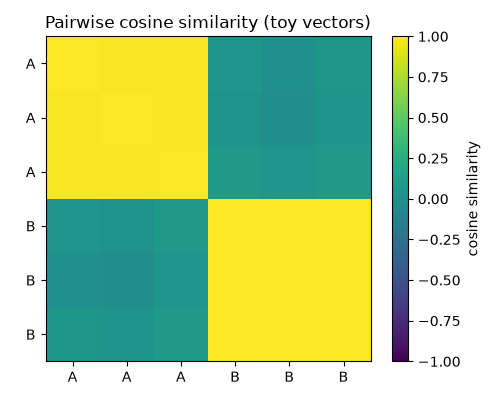
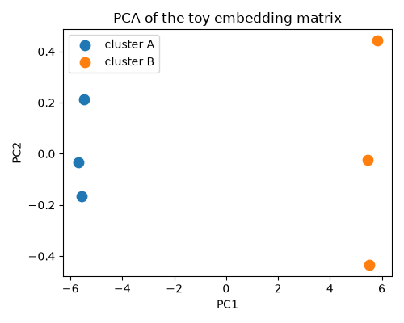

# Module 0 — Embedding Refresher

**Course reference environment: 2026-08 release**

<!--
Welcome slide. This module is optional background for students without a
linear-algebra or GIS background. Everything here uses tiny synthetic data,
not any real provider or dataset — the point is vocabulary, not results.
-->

---

## What you will learn

1. NumPy vectors and L2 normalization
2. Cosine similarity
3. PCA on a toy embedding matrix
4. A tiny classifier with a train/test split
5. CRS reprojection

**Time to complete:** ~25 minutes.

<!--
These five numbered objectives are copied verbatim from the notebook's own
"What you will learn" header cell — not paraphrased. Point out the
prerequisite table from the notebook if asked: no linear algebra or GIS
background is required, only basic Python. Everything the rest of the
course assumes gets built here on toy data first.
-->

---

## Unit-normalize first, then dot product = cosine similarity

<!--
This figure comes straight from the notebook's own output
(figures/00_cosine_similarity_matrix.png) — the toy matrix is L2-normalized
row-wise first (`normalized = toy_matrix / np.linalg.norm(toy_matrix, axis=1,
keepdims=True)`), and only then is the dot product taken
(`normalized @ normalized.T`). Once every row has unit length, that dot
product is exactly the cosine similarity — no separate cosine formula is
needed. Walk through the diagonal being 1.0 (a vector is perfectly similar
to itself) and the off-diagonal block structure showing the toy clusters.
-->

---

## PCA is a visualization aid, not a semantic space

<!--
This is the notebook's figures/00_pca_scatter.png. PCA finds the directions
of maximum variance in the toy matrix and projects onto the first two or
three components purely so we can look at high-dimensional vectors on a 2D
scatter plot. The axes it produces are directions of variance in this
particular sample, not fixed, named, semantically meaningful dimensions.
This sets up the "an axis is not a physical quantity" idea that gets
sharpened again in Module 0b.
-->

---

## WRONG conclusion: skip normalization, compare raw dot products

- **The trap:** "I compared two raw (non-normalized) vectors with a dot
  product and the larger one 'won' — so it must be more similar."
- **Why it's wrong:** a raw dot product mixes direction *and* magnitude. A
  larger-magnitude vector can produce a larger dot product even when its
  *direction* is less aligned with the query than a shorter vector's.
- **Correct framing:** normalize every vector to unit length first
  (`v / ||v||`), *then* take the dot product. Only then does the dot
  product equal the cosine similarity — a pure measure of direction,
  independent of magnitude.

<!--
This is the deliberate conceptual trap for this module. Say it out loud:
"bigger dot product does not mean more similar" if you skipped
normalization. Ask students to predict what happens if you scale one toy
vector by 10x without renormalizing — the raw dot product roughly scales by
10x too, even though the direction (and therefore the true similarity)
hasn't changed at all. This is the same normalize-before-compare discipline
that matters later with real AlphaEarth embedding vectors.
-->

---

## Recap

1. NumPy vectors and L2 normalization
2. Cosine similarity
3. PCA on a toy embedding matrix
4. A tiny classifier with a train/test split
5. CRS reprojection

<!--
Mirrors the objectives slide numbering exactly. Before moving on, confirm
students can state in one sentence why normalizing before taking a dot
product matters — that's the one idea from this module that recurs in
every later module.
-->

---

# Course Reference Environment

- **Course reference environment: 2026-08 release**
- AlphaEarth Foundations Satellite Embedding `DATASET_VERSION`: **1.1**
- GeoTessera: `dataset_version="v1.1", dataset_variant="cambridge"`

<!--
Speaker notes: We pin dataset and library versions because this field
moves fast enough that unpinned material rots. AlphaEarth's own
DATASET_VERSION and GeoTessera's dataset_version/variant are recorded
here so a student re-running these notebooks a year from now gets the
exact same embeddings we used to build every figure and label in this
course, not a newer revision. If a source dataset is later updated, this
course does not silently follow it.
-->

---

# Attribution and Licenses

- **AlphaEarth / Satellite Embedding** (CC BY 4.0): The AlphaEarth Foundations Satellite Embedding dataset is produced by Google and Google DeepMind.

<!--
This module only touches synthetic, toy embedding vectors and a
conceptual walkthrough of AlphaEarth-style vectors -- it never loads
labels, Sentinel-2 bands, WorldCover, Copernicus imperviousness data, or
the LGND Clay corpus, so every other attribution row from
data/DATA_CARD.md is trimmed here. This one row is kept verbatim because
the module frames its running example around AlphaEarth-style embedding
vectors even though the actual numbers used are synthetic.
-->
