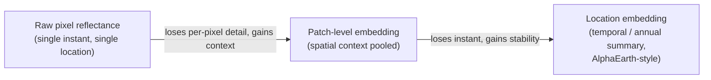

# Module 0b — Representations: Pixel, Patch and Location Embeddings

**Course reference environment: 2026-08 release**

<!--
This is the foundations deck. Where Module 0 built vocabulary on toy data,
this module inspects what an embedding actually represents at three
different spatial scales, using AlphaEarth-style vectors as the running
example.
-->

---

## What you will learn

Objectives copied verbatim from the notebook header:

1. What a raw pixel reflectance vector encodes at a single location
2. What a patch-level embedding (e.g. Clay) adds by pooling spatial context
3. What a location embedding (e.g. AlphaEarth's annual summary) adds by
   pooling temporal context
4. Why a single embedding axis does not correspond to a physical, named
   quantity

<!--
Read straight from the notebook's "What you will learn" cell. This is the
deck where students get the conceptual grounding for "what is an axis of
an embedding, and what is it not" -- everything downstream (similarity
search, classification, change detection) implicitly depends on this
distinction.
-->

---

## Pixel, Patch, Location

<!--
Walk through each arrow left to right. Raw pixel reflectance is the
smallest unit: one instant, one location, no context beyond the pixel
itself. A patch-level embedding (the Clay style) pools a neighborhood of
pixels into one vector, trading per-pixel detail for spatial context. A
location embedding (the AlphaEarth style) goes further and pools across an
entire year, trading the single instant for temporal stability -- one
vector per location per year, robust to clouds and single-date noise. None
of these three representations is "better" in an absolute sense; they
trade different kinds of information for different kinds of robustness,
and picking the right one depends on the task.
-->

---

## WRONG conclusion: reading a latent axis as a physical quantity

- **The trap:** "A17 has a high value here, and high values also show up
  over visibly green areas, so I'll read A17 as an NDVI-like vegetation
  index."
- **Correct framing:** a latent axis does not measure a physical quantity;
  A17 is not NDVI.
- A learned embedding axis is a direction the model found useful for
  reconstructing or predicting its training signal — it can *correlate*
  with a physical quantity in some regions without *being* that quantity
  everywhere, and the correlation can break down outside the conditions it
  was observed under.

<!--
This is the central conceptual trap of the module, and it uses the exact
phrasing from PROJECT.md/CLAUDE.md: "a latent axis does not measure a
physical quantity; A17 is not NDVI." Ask students what would happen if
they tried to threshold A17 the way they'd threshold NDVI for a vegetation
mask -- the boundary would drift by region, season, and sensor, because
A17 was never defined to measure vegetation in the first place.
-->

---

## Custom Satellite Embeddings

Custom Satellite Embeddings: private preview, watch this space

<!--
This line is Google's own forward-looking framing for a not-yet-public
program that would let users train or fine-tune their own satellite
embedding models on top of the same infrastructure as AlphaEarth. It is
mentioned here purely for portability awareness -- it is not something
this course depends on, requires access to, or teaches against. Flag
clearly to students that this is "watch this space," not a course
prerequisite or a guaranteed future feature.
-->

---

## Recap

1. What a raw pixel reflectance vector encodes at a single location
2. What a patch-level embedding (e.g. Clay) adds by pooling spatial context
3. What a location embedding (e.g. AlphaEarth's annual summary) adds by
   pooling temporal context
4. Why a single embedding axis does not correspond to a physical, named
   quantity

<!--
Mirrors the objectives slide numbering. Before moving on, confirm students
can say in their own words why A17 is not NDVI -- that idea recurs any
time this course touches classification thresholds or "what does this
number mean" questions in later modules.
-->

---

# Course Reference Environment

- **Course reference environment: 2026-08 release**
- AlphaEarth Foundations Satellite Embedding `DATASET_VERSION`: **1.1**
- GeoTessera: `dataset_version="v1.1", dataset_variant="cambridge"`

<!--
Same version pin discipline as every other module: unpinned datasets and
libraries rot, so we record the exact AlphaEarth DATASET_VERSION and
GeoTessera dataset_version/variant used to build every figure in this
course.
-->

---

# Attribution and Licenses

- **AlphaEarth / Satellite Embedding** (CC BY 4.0): The AlphaEarth Foundations Satellite Embedding dataset is produced by Google and Google DeepMind.

<!--
This module discusses AlphaEarth-style location embeddings by name as its
running example for the "location embedding" branch of the taxonomy, so
this one attribution row is kept verbatim. It does not load Sentinel-2
bands, WorldCover, Copernicus imperviousness, or the LGND Clay corpus, so
those rows are trimmed.
-->
