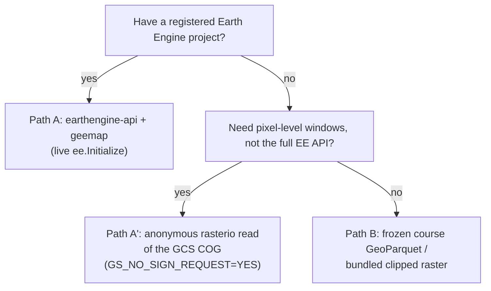
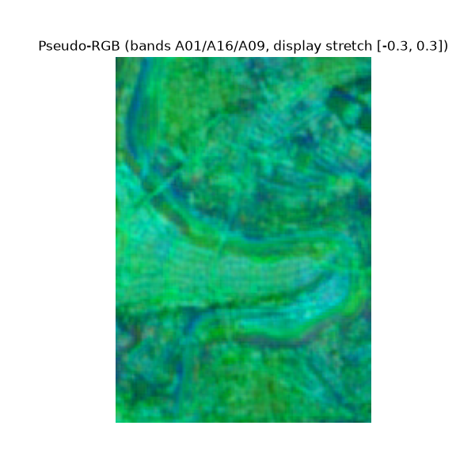
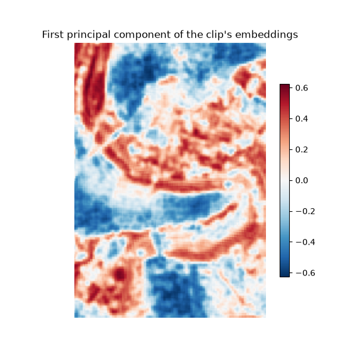

# Module 2 — Accessing and Visualizing AlphaEarth

**Course reference environment: 2026-08 release**

<!--
This module reaches the same AlphaEarth embedding either directly from
Earth Engine (Path A, for students who have a registered project) or with
zero credentials from a bundled, clipped raster (Path B). Time to
complete: ~15 minutes for Path A (requires a registered EE project);
Path B needs nothing.
-->

---

## What you will learn

1. Load an AlphaEarth Satellite Embedding image from Earth Engine (Path A)
2. Read the same embedding anonymously from the underlying cloud raster,
   with no Earth Engine account (Path A')
3. Dequantize the int8-quantized embedding correctly
4. Build a static pseudo-RGB visualization and a PCA composite
5. (Path B) Reach the same conclusions with the bundled clip and no Earth
   Engine account

<!--
Objectives quoted from the notebook's own header cell. Note honestly:
this notebook's own code demonstrates Path A (live Earth Engine) and
Path B (the bundled offline clip) end to end; Path A' -- the anonymous
GCS COG read via rasterio with GS_NO_SIGN_REQUEST -- is a real, separately
verified access pattern (see CLAUDE.md's "Access patterns verified"
section) that this deck's decision flowchart surfaces as an option for
completeness, even though this particular notebook does not execute it
as a numbered code cell.
-->

---

## Which AlphaEarth access path?

<!--
Path A needs a registered, EE-enabled Google Cloud project and
ee.Initialize(project=...) -- the notebook wraps this in a try/except so
it falls back cleanly if the account isn't available. Path A' is the
anonymous rasterio.Env(GS_NO_SIGN_REQUEST="YES") read of
gs://alphaearth_foundations/... directly -- no Earth Engine account at
all, verified live (64 bands, int8, nodata -128, 8192x8192 tiles). Path B
is what this notebook's own code actually runs by default: the bundled,
already-clipped data/bern_aef_2024_clip.tif, needing zero credentials and
zero network access. Every path reaches the same underlying AlphaEarth
values; they differ only in how much of Earth Engine's infrastructure you
need to touch to get there.
-->

---

## Static pseudo-RGB from three embedding bands

<!--
This is figures/01_pseudo_rgb.png from the notebook's own Path B section.
It picks the same illustrative band triple as Path A (A01, A16, A09),
stretches values into the 0-1 display range, and renders them as if they
were red/green/blue channels purely for visual inspection. It is not a
true-color image -- there is no reason A01/A16/A09 correspond to physical
red/green/blue wavelengths.
-->

---

## PCA on the clip

<!--
This is figures/01_pca.png. Three principal components of the clip's
embedding vectors are computed and rendered as an RGB-style composite so
distinct land-cover types visually separate into distinct colors -- purely
because PCA maximizes variance across the sample, not because those
colors were assigned any semantic label.
-->

---

## WRONG conclusion: reading PCA colors as land-cover classes

- **The trap:** "The pseudo-RGB PCA composite looks like a classified
  land-cover map, so I'll read each distinct color as a class label
  (forest, water, urban, ...)."
- **Correct framing:** PCA components are unlabelled directions of maximum
  variance in this particular sample -- not semantic classes. A PCA
  component separates landscape types observed *in this sample*, but the
  same color in a different scene, a different date, or a different PCA
  fit is not guaranteed to mean the same thing.
- Turning colors into labels requires an actual classifier trained on
  labeled data (later modules), not a visual read of a PCA composite.

<!--
Say this out loud with the PCA figure on screen: "different colors here
mean different directions of variance in this one image, not officially
defined classes." This connects directly back to the "A17 is not NDVI"
trap from Module 0b -- both are instances of over-interpreting an
unlabelled, learned or derived dimension as if it carried a fixed
physical or semantic meaning.
-->

---

## Recap

1. Load an AlphaEarth Satellite Embedding image from Earth Engine (Path A)
2. Read the same embedding anonymously from the underlying cloud raster,
   with no Earth Engine account (Path A')
3. Dequantize the int8-quantized embedding correctly
4. Build a static pseudo-RGB visualization and a PCA composite
5. (Path B) Reach the same conclusions with the bundled clip and no Earth
   Engine account

<!--
Mirrors the objectives slide numbering. Reinforce: Path A' and Path B are
both anonymous, unauthenticated access patterns -- neither implies any GCP
billing account or Earth Engine registration, which matters for students
without institutional cloud access.
-->

---

# Course Reference Environment

- **Course reference environment: 2026-08 release**
- AlphaEarth Foundations Satellite Embedding `DATASET_VERSION`: **1.1**
- GeoTessera: `dataset_version="v1.1", dataset_variant="cambridge"`

<!--
Same pin discipline as every module. AlphaEarth's DATASET_VERSION 1.1 is
what every figure and dequantization in this module was built against.
-->

---

# Attribution and Licenses

- **AlphaEarth / Satellite Embedding** (CC BY 4.0): The AlphaEarth Foundations Satellite Embedding dataset is produced by Google and Google DeepMind.

<!--
This module loads and visualizes AlphaEarth embedding data directly (live
via Earth Engine or from the bundled clip), so this row is kept verbatim.
It never touches WorldCover, Copernicus imperviousness, Sentinel-2
reflectance bands, or the LGND Clay corpus, so those rows are trimmed.
Path A' and Path B are anonymous, unauthenticated reads -- no GCP billing
account is implied by either.
-->
