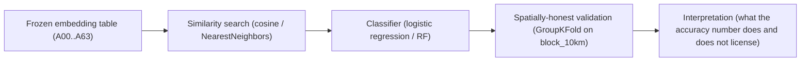
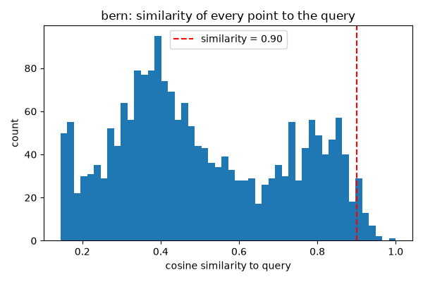
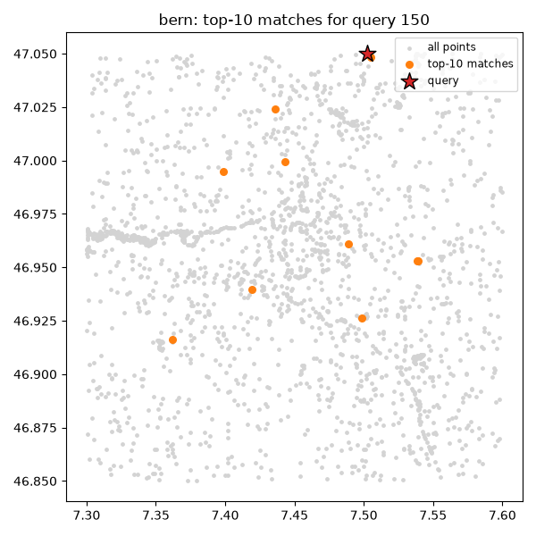
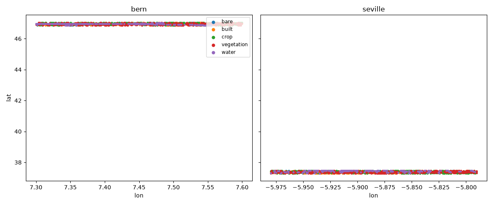
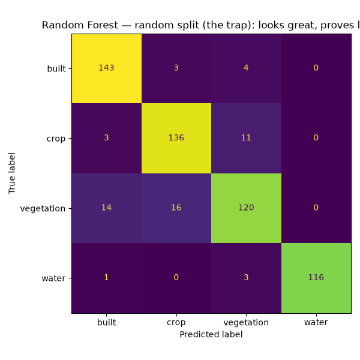
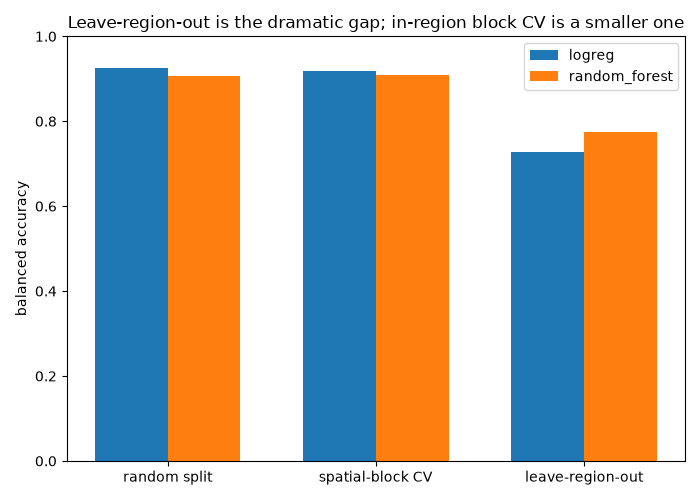
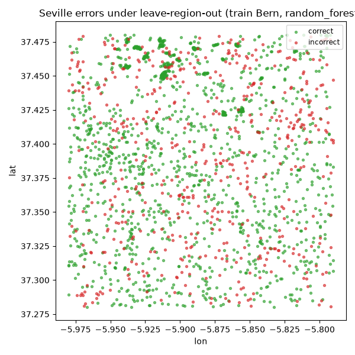
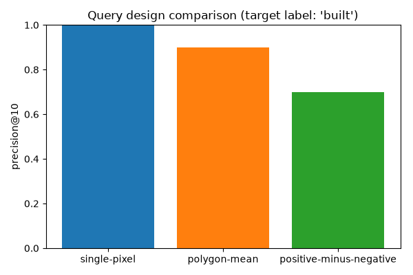

# Module 2: Similarity Search and Classification

The flagship exercise of the course: take a precomputed AlphaEarth (Google
Satellite Embedding) field for two geographically distinct regions and show
what you can do with embeddings before ever touching a training loop —
search by example, build prototype queries, classify land cover, and
validate the result honestly.

<!--
Speaker notes: This is the notebook we keep coming back to for the rest of
the course. Everything downstream (change detection, ecosystems, capstone)
reuses the same embedding table, the same block_10km spatial grouping, and
the same "random split lies to you" lesson this deck exists to land.
-->

---

## What you will learn

1. Cosine similarity search-by-example over a 64-dimensional embedding
2. Prototype queries built from a polygon mean and from positive-minus-negative centroids
3. A 2-4 class land-cover classifier
4. Why random splits, spatial-block splits and leave-region-out splits give different, honest answers
5. How the embedding classifier compares to a raw-Sentinel-2-band baseline

<!--
Speaker notes: Point 4 is the one the quiz will actually test. Everything
else in this module is scaffolding to get us to a classifier whose accuracy
number we can trust or distrust for the right reasons.
-->

---

## The Analytical Chain

<!--
Speaker notes: Every step in this chain is a separate notebook section.
The chain matters because each step can silently break the ones after it —
a classifier trained on leaky similarity features, or validated with the
wrong split, produces a number that looks fine and means nothing. The last
box is the one students skip if we let them; it is the whole point.
-->

---

## Similarity: every point vs. a query

The distribution of cosine similarity from every point in the region to a
single query point — most of the mass sits well below 1.0, with a marked
tail above the 0.90 line we probe next.

<!--
Speaker notes: This is the figure right before the trap cell. Ask the room
where they would draw a "same class" cutoff before revealing why any
cutoff is arbitrary.
-->

---

## Top-k matches for a query

The query point plus its top-K nearest neighbours by cosine similarity,
plotted in geographic space — ranking, not thresholding, is the operation
a search-by-example workflow actually needs.

<!--
Speaker notes: Notice the matches are not necessarily adjacent pixels —
similarity in embedding space is not the same as proximity in geographic
space. That is the point of embeddings over raw coordinates.
-->

---

## All labelled points in the AOI

Every labelled sample point across both study regions (Bern, Seville),
color-coded by land-cover label — the raw material for both the
similarity search and the classifier sections.

<!--
Speaker notes: This map is also where we first show the two regions are
geographically distinct — the fact that makes leave-region-out later in
this deck a meaningful, non-trivial test.
-->

---

## WRONG CONCLUSION: "similarity > 0.90 means same land cover"

> WRONG: `{same_class_rate:.0%}` of points with similarity > 0.90 share the
> query's label, so a similarity above 0.90 must mean "same land cover."

**Why this is wrong:** the 0.90 cutoff is arbitrary — nothing about the
embedding's geometry singles out 0.90 as a meaningful boundary. Pick 0.85
or 0.95 instead and the apparent "agreement rate" changes with it, even
though nothing about the underlying data changed. A fixed threshold
answers "how many points cross an arbitrary line," not "how good is this
query." Ranking, plus precision@k, is the honest alternative.

<!--
Speaker notes: This is the notebook's own tagged wrong-conclusion cell
(notebooks/solutions/02_similarity_and_classification.py, tag
"wrong-conclusion", the same_class_rate cell right after the similarity
histogram). Reproduced verbatim, not paraphrased. The correct-framing text
below it ("Why this is wrong") is also verbatim from the notebook's
following markdown cell.
-->

---

## The trap: random-split accuracy looks great

Random Forest confusion matrix under an ordinary `train_test_split` — high
accuracy, clean diagonal. It looks great, and proves very little.

<!--
Speaker notes: Notebook caption for this exact figure is "Random Forest —
random split (the trap): looks great, proves little." A random split lets
adjacent points — potentially metres apart — land on opposite sides of
train/test, and AlphaEarth embeddings make this worse than raw pixels
because a full year of spatial/temporal context is baked into every
embedding (PITFALLS.md Pitfall 2).
-->

---

## Spatial validation: three honest answers

Balanced accuracy across three validation regimes for the same classifier:
random split, in-region spatial-block `GroupKFold`, and leave-region-out
(`LeaveOneGroupOut`, train Bern → predict Seville).

<!--
Speaker notes: This is the notebook's own headline figure. Read the bars
left to right — random split is highest, spatial-block CV drops a little,
leave-region-out drops a lot. That ordering is the lesson.
-->

---

## WRONG CONCLUSION → the honest number

The notebook's own headline result: leave-region-out shows **a double-digit
balanced-accuracy drop** relative to the random-split and block-CV numbers
— consistent with a comparable measurement on this data
(02-RESEARCH.md: **17-19 points for logistic regression and random
forest**, train Bern → predict Seville). In-region spatial-block CV, by
contrast, showed only a **1-4 point** gap.

**Leave-region-out is the primary evidence that a random split lies here** —
the in-region block-vs-random gap is a real, smaller, second lesson about
interpolation vs. extrapolation, not the dramatic effect.

<!--
Speaker notes: Source cell is the markdown block immediately after the
leave-region-out print loop in
notebooks/solutions/02_similarity_and_classification.py (line ~605-614),
which cites "02-RESEARCH.md: 17-19 points for logistic regression and
random forest" verbatim. We do not invent a sharper number than the
notebook itself reports — it reports a range, not a single figure, and we
carry that range through to this slide rather than rounding it away.
-->

---

## Where leave-region-out hurts: Seville errors

Misclassified Seville points under leave-region-out (train Bern, predict
Seville, Random Forest) — the model trained on one region loses a large
fraction of its accuracy the moment it has to extrapolate to another.

<!--
Speaker notes: Notebook title for this exact figure: "Seville errors under
leave-region-out (train Bern, random_forest)." This is the same effect
the bar chart quantified, now shown spatially so the class of errors is
visible, not just the aggregate number.
-->

---

## Precision@k for prototype queries

Precision@k for prototype queries (polygon-mean and positive-minus-negative
centroid) as k grows — the honest replacement for the arbitrary 0.90
threshold from the wrong-conclusion slide.

<!--
Speaker notes: This figure closes the loop on the similarity half of the
notebook: instead of asking "how many points cross a threshold," we ask
"how good are the top-k matches," which is the question a search-by-example
workflow actually needs answered.
-->

---

## Recap

- Cosine similarity ranks candidates; a fixed threshold like 0.90 does not
  generalize and should never stand in for validated precision@k.
- A random train/test split on spatially autocorrelated embeddings
  overstates accuracy — often dramatically.
- Leave-region-out (train Bern → predict Seville) is the honest,
  generalization-relevant estimate: **17-19 points** lower than the
  random-split number, per this notebook and 02-RESEARCH.md.
- In-region spatial-block CV costs much less (1-4 points) — a smaller,
  separate lesson about interpolation vs. extrapolation.

<!--
Speaker notes: If a student takes away one sentence from this whole
course, it should be: "the split you validate on determines whether your
accuracy number means anything." This notebook is where we prove it with
real numbers on real data, not an abstract warning.
-->

---

# Course Reference Environment

- **Course reference environment: 2026-08 release**
- AlphaEarth Foundations Satellite Embedding `DATASET_VERSION`: **1.1**
- GeoTessera: `dataset_version="v1.1", dataset_variant="cambridge"`

<!--
Speaker notes: We pin dataset and library versions because this field
moves fast enough that unpinned material rots. AlphaEarth's own
DATASET_VERSION and GeoTessera's dataset_version/variant are recorded
here so a student re-running these notebooks a year from now gets the
exact same embeddings we used to build every figure and label in this
course, not a newer revision. If a source dataset is later updated, this
course does not silently follow it.
-->

---

# Attribution and Licenses

- **AlphaEarth / Satellite Embedding** (CC BY 4.0): The AlphaEarth Foundations Satellite Embedding dataset is produced by Google and Google DeepMind.
- **ESA WorldCover 2021 v200** (CC BY 4.0): © ESA WorldCover project 2021
  / Contains modified Copernicus Sentinel data (2021) processed by ESA
  WorldCover consortium (citation: Zanaga et al. 2022,
  https://doi.org/10.5281/zenodo.7254221)
- **Sentinel-2 L2A (derived reflectance bands)** (EU legal notice, Reg.
  1159/2013): Contains modified Copernicus Sentinel data [Year] (the
  actual year is recorded per-table in that table's own
  `course_provenance`)

<!--
Speaker notes: This module trains its classifier against ESA WorldCover
2021-derived labels and also runs a raw-Sentinel-2-band baseline, so both
of those rows are kept from the shared attribution partial; the
Copernicus HRL Imperviousness and LGND Clay rows are trimmed here because
this module does not touch either source (they belong to the change-
detection and ecosystems modules respectively).
-->
