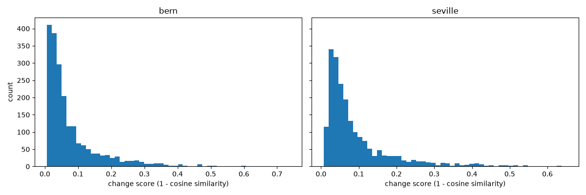
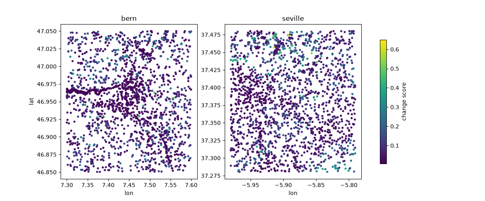
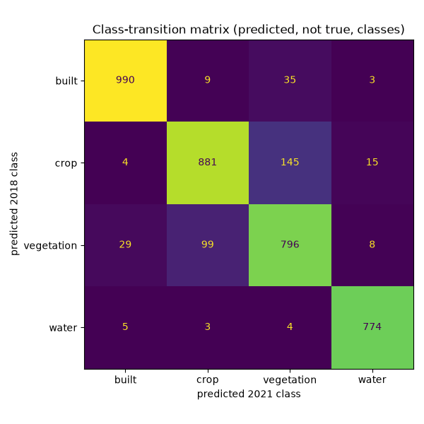
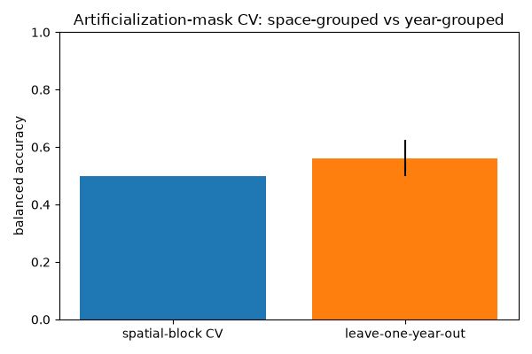

# Module 3: Change Detection and Validation

A naive threshold on `1 - cosine_similarity` between two years of AlphaEarth
embeddings shows exactly how it misleads you, then calibrates a threshold
against an independent reference so the result comes with a known
precision, recall, and F1 instead of an eyeballed cutoff.

<!--
Speaker notes: This module is the direct sequel to Module 2's spatial-
validation lesson, applied to change detection instead of classification.
Same discipline, different failure mode: here the trap is an unvalidated
threshold rather than an unvalidated split.
-->

---

## What you will learn

1. `1 - cosine_similarity` as a per-point change score between two years
2. Why a fixed change-score threshold is not itself a semantic-change decision
3. Calibrating a threshold against an independent reference with `precision_recall_curve`

<!--
Speaker notes: Point 2 is where the wrong-conclusion cell lives. Point 3 is
where the honest, low-precision number comes from — 0.065 precision is not
a failure of the method, it is what happens when you validate honestly
against a weak proxy label.
-->

---

## 1 − cosine measures representation movement

**1 − cosine measures representation movement, not semantic transition;
artificialization needs classified transitions or calibrated change
labels.**

<!--
Speaker notes: This sentence is verbatim from .planning/PROJECT.md's
pitfalls list. A moved representation (a large 1-cosine value) is
necessary evidence that *something* changed in the embedding space, but it
is not sufficient evidence of a real-world land-cover change: harvest
cycles, a drought year, early snow cover, or a swath-boundary artifact in
the underlying imagery can move a point's embedding by as much as genuine
land-cover change does (Google's own analysis found "widespread speckling,
scattered false positives" from exactly this kind of naive thresholding).
Treating a large change score as a semantic-change verdict is Pitfall 5 of
this course.
-->

---

## Change score distribution, two study regions

`1 - cosine_similarity` per point, split by region (Bern, Seville) — most
points show a small representation shift; a minority show a large one.

<!--
Speaker notes: Notebook x-axis label for this exact figure: "change score
(1 - cosine similarity)." This is the distribution the wrong-conclusion
cell's 0.25 threshold gets applied to next.
-->

---

## Change score, mapped

The same per-point change scores plotted in geographic space, colored by
magnitude — spatial structure in the change signal is visible before any
threshold is applied.

<!--
Speaker notes: Point out that high-change points are not randomly
scattered — there is real spatial structure. That is what makes the naive
threshold tempting, and also what makes a calibrated one worth the extra
step.
-->

---

## WRONG CONCLUSION: "change_score > 0.25 means artificialized"

> WRONG: `bern={n} of {n} points flagged, seville={n} of {n} points
> flagged`

It is tempting to pick a threshold by eye and call every point above it
"artificialized." The cell above does exactly that — and it is wrong.

**Why this is wrong:** `1 - cosine_similarity` collapses the full
64-dimensional embedding into one number, and 0.25 was picked by eye with
no reference data behind it. A large change score means the
*representation* moved; it does not by itself mean the *land cover*
changed, let alone that it became "artificialized" specifically. Treating
an unvalidated cutoff as a semantic-change decision is Pitfall 5 of this
course.

<!--
Speaker notes: This is the notebook's own tagged wrong-conclusion cell
(notebooks/solutions/03_change_detection_and_validation.py, tag
"wrong-conclusion", the `artificialized = change_df["change_score"] >
0.25` cell), reproduced verbatim along with its immediately following
"Why this is wrong" markdown cell. Do not soften "and it is wrong" — that
phrasing is deliberate and in the source.
-->

---

## Calibrating a threshold against a proxy reference

Instead of asserting a cutoff, the notebook calibrates one against known
controls (`precision_recall_curve` on independently-known change/no-change
points) and picks the threshold that maximizes F1.

**Measured result** (notebooks/solutions/03_change_detection_and_validation.py,
verified against the executed notebook's own printed output):

- calibrated threshold (max F1 on controls): **0.023**
- **precision = 0.065**, recall = 0.933, F1 = 0.121

<!--
Speaker notes: A weak proxy label yields a weak, honestly-measured
detector — this is not a broken pipeline. The controls here rest on only
208 positive examples, and the reference label itself is a single 2021
snapshot rather than a genuine two-epoch change label (see this project's
05-02-SUMMARY.md, which reports this exact number from the executed
notebook). The true HRL 2018-2021 change product, which sits behind an EU
Login the course cannot assume every student has, is the correct
reference a credentialed student should substitute. The number is low
because the label is weak, not because 1-cosine is a bad signal — recall
0.933 shows the signal itself is catching almost every known change; it is
just also catching a lot else, which is exactly why "0.25 means
artificialized" was never a safe conclusion.
-->

---

## Land-cover transitions, calibrated threshold

Land-cover class transitions (2018 → 2021) among points the calibrated
threshold flags as changed, cross-tabulated against the classifier's
predicted labels in each year.

<!--
Speaker notes: This is the artificialized_mask cross-tab from the
notebook — vegetation-to-built transitions dominate among flagged points,
which is the semantically meaningful signal a raw threshold on 1-cosine
cannot distinguish on its own from noise.
-->

---

## Spatiotemporal validation comparison

Leave-one-year-out cross-validation compared against an in-sample
estimate for the change classifier — the same spatial/temporal-honesty
discipline from Module 2, applied here across time.

<!--
Speaker notes: Leave-one-year-out balanced accuracy in this notebook's
family of experiments came in around 0.562 ± 0.062 (per this project's
05-03-SUMMARY.md) — a modest, honestly-validated number, consistent with
the theme that every validated number in this course is smaller and more
trustworthy than its naive counterpart.
-->

---

## Recap

- `1 - cosine` measures representation movement, not semantic transition —
  it is necessary but not sufficient evidence of real-world change.
- An eyeballed threshold (0.25) is Pitfall 5: it has no precision, no
  recall, and no F1 behind it.
- Calibrating against a proxy reference gives an honest, low number —
  **precision 0.065, recall 0.933, F1 0.121** at threshold 0.023 — because
  the proxy label itself is weak (208 controls, single-snapshot), not
  because the pipeline is broken.
- A weak, honestly-measured detector is more useful than a confident,
  unvalidated one — it tells you exactly how much to trust its output.

<!--
Speaker notes: If students remember one number from this module, it
should be precision 0.065 — not as a failure, but as proof the notebook
did the validation instead of skipping it. That is the entire point of
this course's approach to spatial/temporal honesty.
-->

---

# Course Reference Environment

- **Course reference environment: 2026-08 release**
- AlphaEarth Foundations Satellite Embedding `DATASET_VERSION`: **1.1**
- GeoTessera: `dataset_version="v1.1", dataset_variant="cambridge"`

<!--
Speaker notes: We pin dataset and library versions because this field
moves fast enough that unpinned material rots. AlphaEarth's own
DATASET_VERSION and GeoTessera's dataset_version/variant are recorded
here so a student re-running these notebooks a year from now gets the
exact same embeddings we used to build every figure and label in this
course, not a newer revision. If a source dataset is later updated, this
course does not silently follow it.
-->

---

# Attribution and Licenses

- **AlphaEarth / Satellite Embedding** (CC BY 4.0): The AlphaEarth Foundations Satellite Embedding dataset is produced by Google and Google DeepMind.
- **Copernicus HRL Imperviousness Density 2018** (Free/open, commercial
  use allowed): Generated using European Union's Copernicus Land
  Monitoring Service information

<!--
Speaker notes: This module validates its calibrated threshold against the
Copernicus HRL Imperviousness proxy, so that row is kept from the shared
attribution partial alongside AlphaEarth itself; the ESA WorldCover,
Sentinel-2-baseline, and LGND Clay rows are trimmed here because this
module does not touch any of those sources (they belong to the
classification and ecosystems modules respectively).
-->
