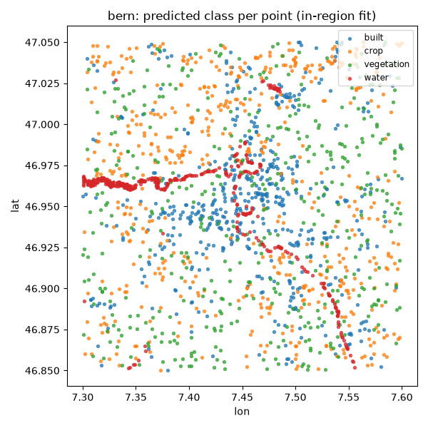
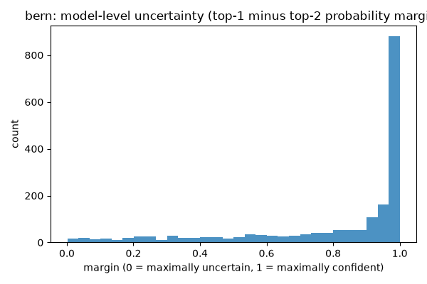

# Module 6: Capstone -- Artificialization Pipeline Template

A template, not a finished analysis: similarity, classification, change
detection and spatially honest validation, tied together end to end.

<!--
Speaker notes: This capstone assembles an end-to-end AOI-to-provenance
pipeline entirely from course helpers already used in Modules 3-5 --
course.data.load, course.schema.to_matrix, course.embeddings.change_score,
course.validation.make_blocks/spatial_cv_report -- on the existing
Bern/Seville frozen data as the worked example. Every EDIT ME cell is a
substitution point for a student's own capstone.
-->

---

## What you will learn

1. How to assemble a full AOI-to-provenance pipeline from reusable course
   helpers, without reimplementing any of them
2. The capstone rubric you are graded against, and what satisfies each row
3. Why the rubric weights validation design above every other criterion

<!--
Speaker notes: Prerequisites are Modules 3 and 4 (similarity/classification
and change/validation); Module 5 (ecosystems) is recommended but not
required. No Earth Engine account is needed. As with every notebook in
this course, this capstone has not been run on Colab as part of building
these slides -- treat any printed numbers as illustrative of the pattern,
not as a guarantee of the exact figures a live re-run will reproduce.
-->

---

## Prediction map

Predicted class per point, fit in-region. This map is deliberately paired
with the uncertainty section that follows it, never left as a standalone
figure.

<!--
Speaker notes: A prediction map on its own invites a reader to treat it as
settled fact. Pair it, always, with the uncertainty view on the next
slide -- especially given how much accuracy the leave-region-out check
(next section) shows this model loses outside its training region.
-->

---

## Uncertainty: model-level margin

Top-1 minus top-2 predicted-class probability margin, per point. Small
margin means the model itself is unsure -- a separate signal from
validation-level fold-to-fold spread (`std_balanced_accuracy`).

<!--
Speaker notes: Model uncertainty (this histogram) and validation
uncertainty (the CV fold spread reported alongside spatial-block CV and
leave-region-out) are two genuinely different kinds of uncertainty.
Conflating them is exactly the overconfidence trap this section exists to
avoid -- a model can show a confident margin on every point and still have
a large validation std.
-->

---

## WRONG conclusion

"The prediction map and its balanced accuracy from spatial-block CV are
enough to trust this classifier anywhere."

**Correct framing:** on this course's measured data (Module 3), the
notebook's own reported pattern is that leave-region-out costs **roughly
17-19 balanced-accuracy points** relative to in-region spatial-block CV,
while spatial-block CV itself costs almost nothing relative to a random
split. In-region spatial blocking is the easy, honest-looking test;
cross-region transfer is the honest, harder test -- and the one that
actually tells you whether this model generalizes.

<!--
Speaker notes: This is the capstone's central trap, worth 30% of the
rubric on its own. A capstone submission that reports only a random
split, or only one of spatial-block CV / leave-region-out, does not
satisfy the validation-design row -- both are required, always reported
side by side, never either/or.
-->

---

## Recap: the six rubric dimensions

| Criterion | Weight |
|---|---|
| Validation design (spatial-block CV **and** leave-region-out, both reported) | 30% |
| Reproducibility and provenance (`build_provenance`/`write_provenance`, pinned dataset versions) | 15% |
| CRS and alignment correctness (reproject before any metre-based operation) | 15% |
| Interpretation and uncertainty (mean ± std, not a single point estimate) | 15% |
| Representation choice (embedding product stated, with an explicit trade-off) | 15% |
| Licensing and ethics (attribution/license of every input, false-positive cost named) | 10% |

<!--
Speaker notes: These are the six weighted criteria from
assessments/05_capstone_rubric.md that a student's own capstone submission
is graded against. Validation design outweighs every other single row --
a convincing classifier with a dishonest validation still fails this
rubric. On ethics: a false "artificialized" flag on someone's land can
trigger real regulatory or compliance consequences, and an inferred label
like "artificialized" can be more sensitive than the underlying imagery
itself.
-->

---

# Course Reference Environment

- **Course reference environment: 2026-08 release**
- AlphaEarth Foundations Satellite Embedding `DATASET_VERSION`: **1.1**
- GeoTessera: `dataset_version="v1.1", dataset_variant="cambridge"`

<!--
Speaker notes: We pin dataset and library versions because this field
moves fast enough that unpinned material rots. AlphaEarth's own
DATASET_VERSION and GeoTessera's dataset_version/variant are recorded
here so a student re-running these notebooks a year from now gets the
exact same embeddings we used to build every figure and label in this
course, not a newer revision.
-->

---

# Attribution and Licenses

- **AlphaEarth / Satellite Embedding** (CC BY 4.0): The AlphaEarth Foundations Satellite Embedding dataset is produced by Google and Google DeepMind.
- **ESA WorldCover 2021 v200** (CC BY 4.0): © ESA WorldCover project 2021
  / Contains modified Copernicus Sentinel data (2021) processed by ESA
  WorldCover consortium (citation: Zanaga et al. 2022,
  https://doi.org/10.5281/zenodo.7254221)
- **Copernicus HRL Imperviousness Density 2018** (Free/open, commercial
  use allowed): Generated using European Union's Copernicus Land
  Monitoring Service information

<!--
Speaker notes: The capstone's worked example (Bern/Seville) uses all
three of these sources for embeddings and labels, so all three rows are
kept here from the shared attribution partial -- Sentinel-2 L2A and LGND
Clay rows are trimmed since this deck's worked example does not touch
those. Every quantitative and visual claim in this deck traces back to
one of these three licensed sources.
-->
